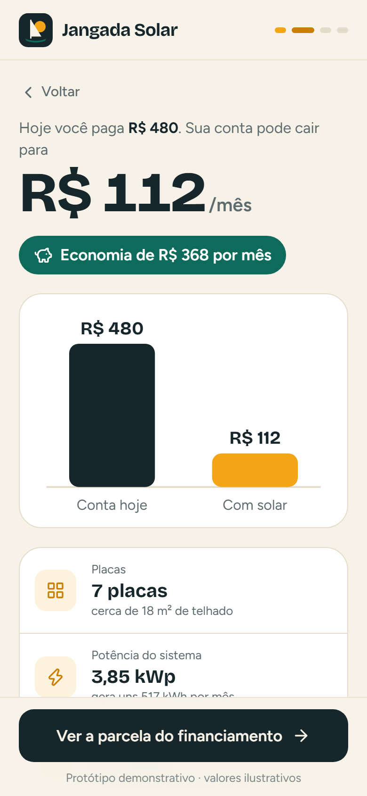
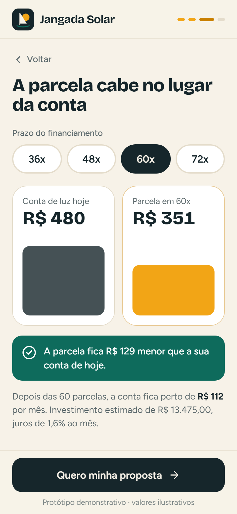
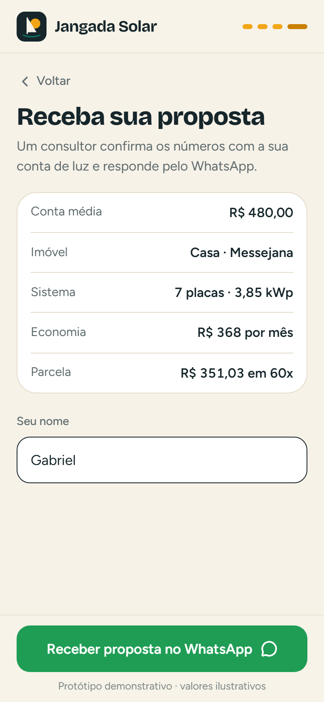

# 01 · Simulador de Economia Solar · palavra **SOL**

Marca fictícia: **Jangada Solar** (integradora de Fortaleza inventada para a demonstração).

O visitante digita quanto paga de luz e descobre sozinho a economia, quantas placas precisa, o tempo de retorno e que a parcela do financiamento cabe no lugar da conta. No fim, pede a proposta pelo WhatsApp com a simulação inteira na mensagem.

| Sua conta | Resultado | Parcela x conta | Proposta |
|---|---|---|---|
|  |  |  |  |

Mensagem gerada no fluxo do vídeo: [`docs/mensagem-whatsapp.txt`](docs/mensagem-whatsapp.txt).

## Como rodar

Na raiz do repositório (uma vez): `npm install`. Depois:

```bash
npm run dev -w apps/01-solar      # abre em http://localhost:5173 (e no celular pela rede)
npm run test -w apps/01-solar     # testes do cálculo e da mensagem
npm run build -w apps/01-solar    # gera apps/01-solar/dist
npm run screens -- 01-solar       # refaz os screenshots de docs/ e confere a mensagem
```

Antes de gravar: abra com `?reset=1` no fim do endereço.

**Roteiro do vídeo:** digita R$ 480 → "Ver minha economia" → "Ver a parcela" (60x, parcela menor que a conta) → "Quero minha proposta" → nome → WhatsApp abre com a mensagem completa.

## Como adaptar para um cliente

Tudo fica em `src/config/`. Não precisa mexer em nenhum componente.

**`marca.json`**
- `nome`, `slogan`: aparecem no topo e no título da aba.
- `logo`: caminho de uma imagem em `public/` (troque `public/img/logo.svg`).
- `whatsapp`: número com DDI e DDD, só dígitos (`5585...`). É para onde a proposta vai.
- `cores`: `primaria` (sol, barras, destaques), `primaria-escura`, `acento` (economia e confirmações), `acento-claro` (céu da ilustração), `fundo`, `superficie` (cartões), `texto`, `suave` (textos secundários), `borda`, `alerta`.
- `fontes.titulo` / `fontes.corpo`: nomes exatos do Google Fonts.

**`dados.json`**
- `tiposImovel`: `id` precisa existir em `calculo.json > disponibilidade_kwh`.
- `bairros`: lista do seletor (o primeiro é o padrão).
- `conta`: `min`, `max`, `passo` e valor `inicial` do slider.
- `prazos` e `prazoInicial`: chips de parcelamento em meses.

**`calculo.json`** (valide com a integradora antes de publicar)
- `tarifa_kwh`: R$ por kWh com impostos (pegue numa conta recente da Enel Ceará).
- `hsp`: horas de sol pleno por dia (Atlas Solarimétrico/CRESESB; Fortaleza fica perto de 5,6).
- `fator_perdas`: 0,8 = 20% de perdas.
- `potencia_painel_kwp`: potência do módulo que a integradora vende (0,55 = 550 W).
- `custo_por_kwp`: preço médio do sistema instalado por kWp.
- `desconto_fio_b`: parte da energia compensada que ainda paga fio B (Lei 14.300; muda ano a ano).
- `reajuste_anual`: usado na economia de 10 anos.
- `taxa_mensal`: juros do financiamento (tabela Price).
- `disponibilidade_kwh`: custo de disponibilidade por tipo de ligação.
- `area_por_placa_m2`: usado para estimar a área de telhado.

**`mensagens.json`**
- `proposta`: template da mensagem. Campos disponíveis: `{conta} {tipo} {bairro} {placas} {kwp} {economia} {parcela} {n} {nome}`.
- `textos`: títulos e frases das telas. Em `parcelaMenor`/`parcelaMaior` use `{diferenca}`.

## O que falta para virar produto

- Tarifa e bandeira automáticas por distribuidora e tipo de ligação (mono/bi/trifásico).
- HSP por cidade/endereço e análise de sombreamento (ex.: Google Solar API).
- Envio do lead para CRM/planilha além do WhatsApp (trocar `src/data/repository.ts`).
- Regras de transição da Lei 14.300 por ano de conexão, custo de manutenção e degradação dos módulos.
- Pixel/eventos de conversão para campanhas.

## Referências e créditos

- Fórmula aberta de calculadoras públicas como a do [ValorFinal](https://valorfinal.com.br/calculadora-energia-solar) (geração por kWp = HSP × 30 × 0,8), com base no Atlas Solar/INPE e CRESESB.
- Lógica de custo x economia inspirada na documentação da Google Solar API (consumo a partir da conta, perdas, energia que ainda vem da distribuidora).
- Padrão de UX de simuladores de integradoras: entrada só com o valor da conta, resultado imediato, CTA de proposta.
- Ilustração e logo desenhados em SVG para este projeto. Ícones: [Lucide](https://lucide.dev) (ISC). Fontes: Bricolage Grotesque e Figtree (Google Fonts, OFL).
- Nenhum código de terceiros foi copiado.
