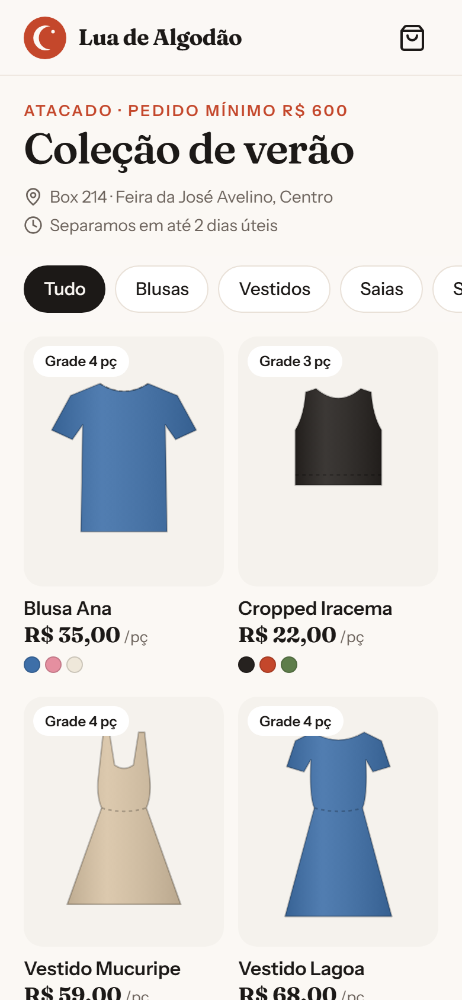
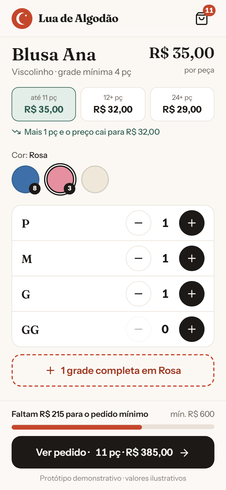
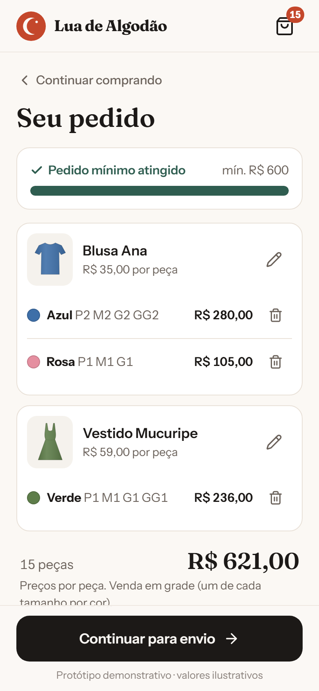
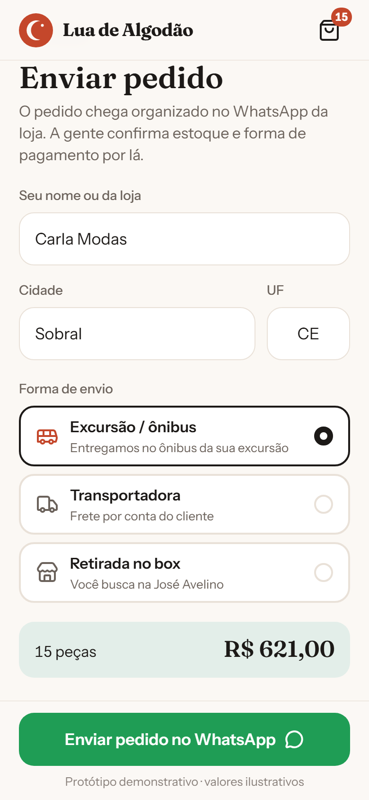

# 02 · Catálogo de Grade para Atacado · palavra **GRADE**

Marca fictícia: **Lua de Algodão** (confecção de moda feminina inventada, com box na Feira da José Avelino).

A revendedora escolhe as peças, monta a grade por cor e tamanho, vê o preço cair quando passa de cada faixa de quantidade, acompanha a barra do pedido mínimo e manda o pedido organizado no WhatsApp do lojista, com cidade e forma de envio (excursão, transportadora ou retirada no box).

| Coleção | Montar grade | Carrinho | Enviar |
|---|---|---|---|
|  |  |  |  |

Mensagem gerada no fluxo do vídeo: [`docs/mensagem-whatsapp.txt`](docs/mensagem-whatsapp.txt).

## Como rodar

Na raiz do repositório (uma vez): `npm install`. Depois:

```bash
npm run dev -w apps/02-atacado
npm run test -w apps/02-atacado
npm run screens -- 02-atacado
```

Antes de gravar: abra com `?reset=1` (o carrinho fica salvo no navegador).

**Roteiro do vídeo:** toca na Blusa Ana → "+1 grade completa" em Azul (duas vezes) e em Rosa → volta e abre o Vestido Mucuripe → grade em Verde → a barra do mínimo fica verde → "Ver pedido" → "Continuar para envio" → nome, cidade, excursão → WhatsApp com o pedido organizado.

## Como adaptar para um cliente

Tudo em `src/config/`:

**`marca.json`**: nome, slogan, logo (`public/img/logo.svg`), `whatsapp` do lojista (só dígitos com DDI), `cores` e `fontes` (Google Fonts).

**`dados.json`**
- `loja.local`: box/endereço exibido na capa.
- `loja.pedido_minimo_valor`: valor do pedido mínimo (a barra e o bloqueio do botão usam esse número).
- `loja.prazo_separacao`, `loja.unidade`: textos de regra comercial.
- `loja.formas_envio[]`: `id` (`excursao`, `transportadora` ou `retirada` têm ícone próprio), `rotulo`, `descricao`.
- `categorias[]`: chips do filtro, na ordem.
- `produtos[]`:
  - `id` (vai na URL `#/produto/<id>`), `nome`, `categoria`, `tecido`.
  - `modelo`: desenho usado quando não há foto (`blusa`, `cropped`, `vestido`, `longo`, `saia`, `short`).
  - `fotos[]`: caminhos em `public/` (ex.: `img/blusa-ana.jpg`). Se tiver foto, ela substitui o desenho.
  - `cores[]`: `{ nome, hex }`. O desenho é pintado com o `hex`.
  - `tamanhos[]`: ordem da grade (`P M G GG`, `36 38 40 42`…).
  - `preco_atacado`: preço por peça antes da primeira faixa.
  - `faixas[]`: `{ min_pecas, preco }`. A faixa conta todas as cores daquela peça.
  - `grade_minima`: número exibido no selo.

**`mensagens.json`**
- `pedido.cabecalho`: `{loja} {nome} {cidade} {uf} {envio}`.
- `pedido.item`: uma linha por peça e cor: `{produto} {cor} {grade} {pecas} {valor}`.
- `pedido.rodape`: `{pecas} {total}`.
- Use `*texto*` para negrito no WhatsApp.
- `textos`: frases das telas (`{falta}`, `{faltam}`, `{preco}`).

## O que falta para virar produto

- Estoque real por cor e tamanho (bloquear o que acabou).
- Painel do lojista para cadastrar peças e fotos (o `repository.ts` já está pronto para trocar o JSON por planilha ou Supabase).
- Pagamento (Pix com comprovante) e histórico de pedidos por cliente.
- Tabela de preço por cliente (revendedora antiga x nova).

## Referências e créditos

- **Capim Catalog** (`marciodiasdeveloper/capim-catalog`, MIT): estudado o padrão de preço de atacado por faixa calculado em tempo real e checkout por `wa.me`. Nenhum código foi copiado; a lógica aqui foi escrita do zero em `src/lib/atacado.ts`.
- Plugins de pedido por WhatsApp para WooCommerce e módulos de atacado: pedido mínimo por valor, variações de cor/tamanho na mensagem.
- Desenhos das peças feitos em SVG para este projeto. Ícones: [Lucide](https://lucide.dev) (ISC). Fontes: Fraunces e Instrument Sans (Google Fonts, OFL).
