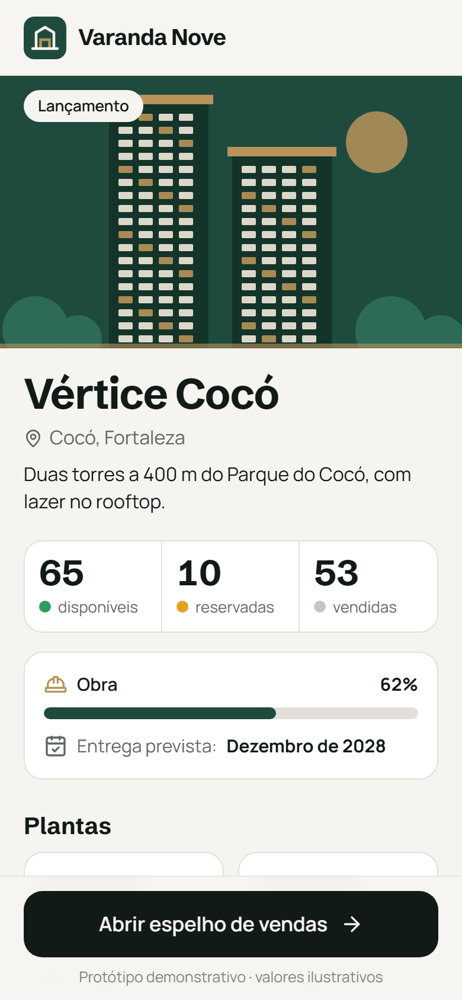
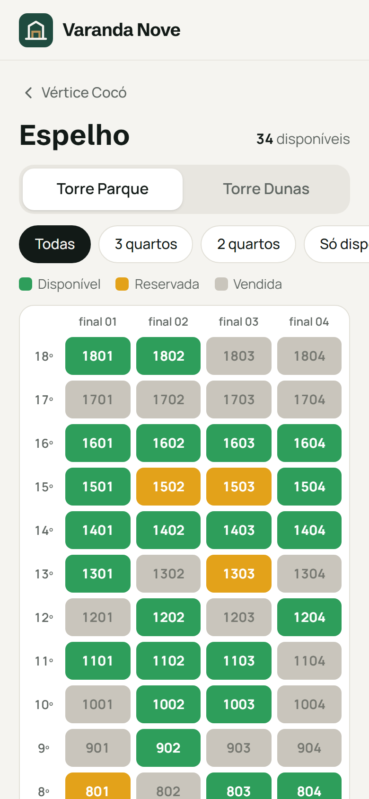
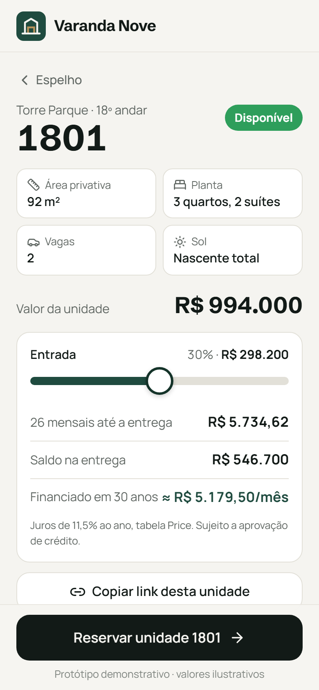
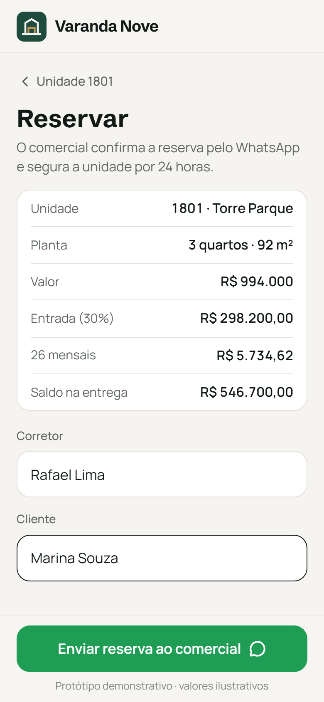

# 03 · Espelho de Vendas · palavra **ESPELHO**

Marca fictícia: **Varanda Nove** (incorporadora inventada), empreendimento **Vértice Cocó** (duas torres no Cocó).

O corretor vê no celular o que está disponível no lançamento, filtra por planta, toca numa unidade verde, simula entrada, mensais da obra e saldo financiado, copia o link da unidade para mandar ao cliente e reserva com o comercial pelo WhatsApp.

| Empreendimento | Espelho | Unidade | Reservar |
|---|---|---|---|
|  |  |  |  |

Mensagem gerada no fluxo do vídeo: [`docs/mensagem-whatsapp.txt`](docs/mensagem-whatsapp.txt).

## Como rodar

```bash
npm run dev -w apps/03-espelho
npm run test -w apps/03-espelho
npm run screens -- 03-espelho
```

Antes de gravar: `?reset=1` (apaga o nome do corretor salvo).

**Roteiro do vídeo:** "Abrir espelho de vendas" → toca numa unidade verde (ex.: 1801) → arrasta a entrada → "Reservar unidade" → corretor e cliente → WhatsApp do comercial com unidade e simulação.

Cada unidade tem link próprio: `.../espelho/#/unidade/A-1801` (bloco-andar+final).

## Como adaptar para um cliente

**`marca.json`**: incorporadora, logo, `whatsapp` do comercial, cores e fontes.

**`dados.json`**
- `empreendimento`: `nome`, `bairro`, `descricao`, `obra_percentual`, `entrega`, `diferenciais`.
- `status[]`: `{ id, rotulo, cor }`. Os ids `disponivel`, `reservada`, `vendida` são usados pelo app; rótulo e cor são livres.
- `blocos[]`: `{ id, nome, andares, finais[] }`. As unidades são geradas sozinhas (andar + final).
- `tipologias[]`: `{ id, rotulo, area, suites, vagas, finais[], preco_m2 }`. Cada final pertence a uma tipologia.
- `sol_por_final`: posição do sol de cada final.
- `acrescimo_por_andar`: 0,006 = +0,6% no preço a cada andar.
- `distribuicao`: `semente` (troque o número para outro sorteio fixo), `vendida` (0,4 = ~40%), `reservada`.

**`calculo.json`** (tabela de vendas)
- `entrada_minima`, `entrada_maxima`, `entrada_padrao`: limites do slider (0,2 = 20%).
- `percentual_mensais_obra`: quanto do preço é pago em mensais durante a obra.
- `meses_ate_entrega`: número de mensais.
- `taxa_anual_financiamento`, `prazo_financiamento_meses`: estimativa da parcela do saldo (Price).

**`mensagens.json`**: `reserva` com `{empreendimento} {unidade} {bloco} {area} {tipologia} {entrada} {n} {mensal} {saldo} {corretor} {cliente}`; `textos` das telas.

## O que falta para virar produto

- Status em tempo real alimentado pelo comercial (planilha ou Supabase em `src/data/repository.ts`, no lugar da semente).
- Login de corretor e trava de reserva com prazo (24 h) para evitar duas reservas na mesma unidade.
- Planta baixa por tipologia, fotos decoradas, tour virtual.
- Integração com CRM (Vimob, Hypnobox, RD) e tabela de vendas com correção pelo INCC.

## Referências e créditos

- Padrão de espelho de vendas do **Vimob** e do **Hypnobox** (documentação pública): status com cores configuráveis, navegação por bloco, filtros e reserva a partir do espelho.
- Espelhos interativos de mercado: link por unidade para o corretor mandar ao comprador.
- Gerador com semente: algoritmo mulberry32 (domínio público), reescrito em `src/lib/espelho.ts`.
- Ilustração em SVG feita para este projeto. Ícones: [Lucide](https://lucide.dev) (ISC). Fontes: Schibsted Grotesk e Manrope (Google Fonts, OFL).
