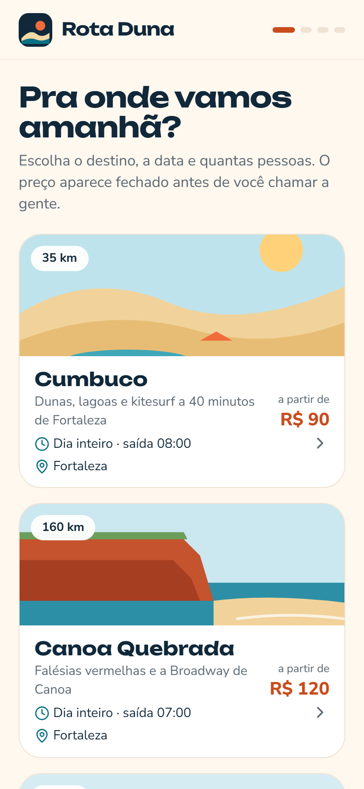
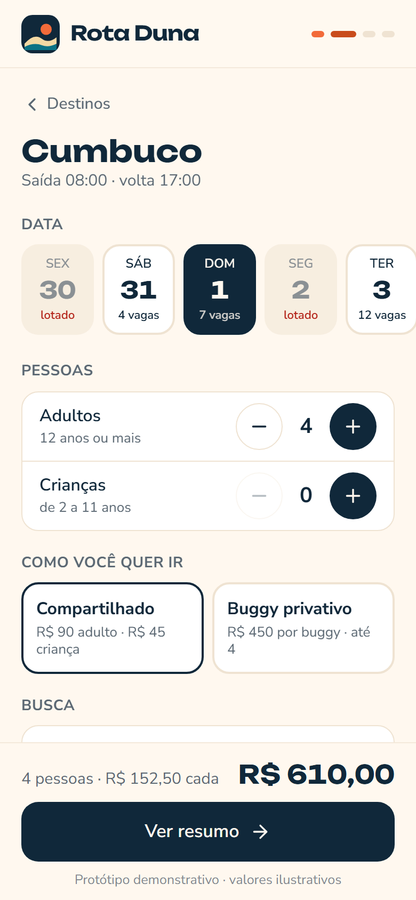
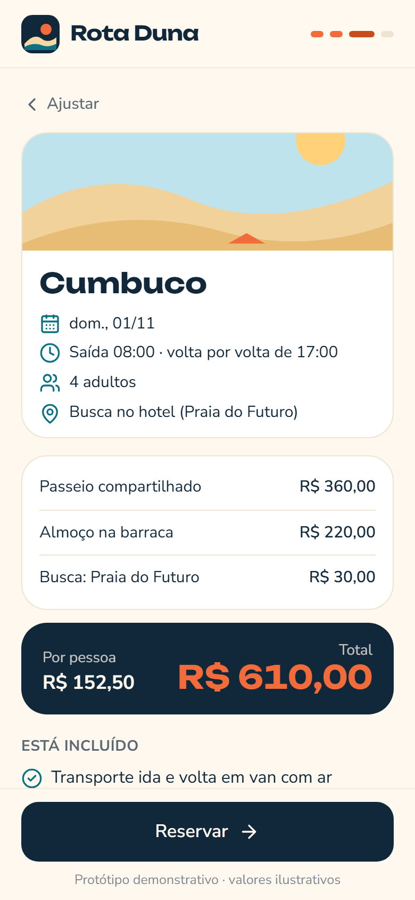
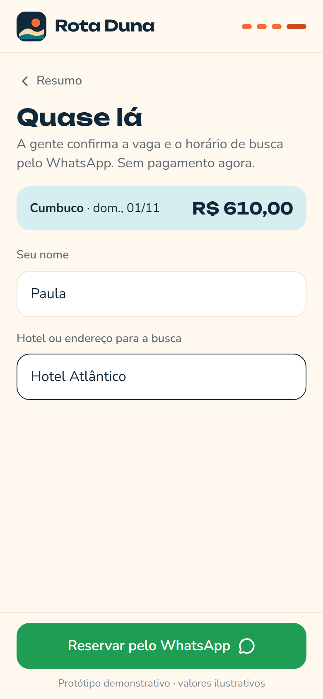

# 04 · Monte seu Passeio · palavra **PASSEIO**

Marca fictícia: **Rota Duna** (receptivo e passeios de buggy inventado, saída da Beira-Mar).

O turista escolhe o destino, a data (com dias lotados e vagas restantes), quantos adultos e crianças, passeio compartilhado ou buggy privativo, busca no hotel por zona e extras. O preço fechado aparece na hora e a reserva vai para o WhatsApp do receptivo.

| Destinos | Configurar | Resumo | Reservar |
|---|---|---|---|
|  |  |  |  |

Mensagem gerada no fluxo do vídeo: [`docs/mensagem-whatsapp.txt`](docs/mensagem-whatsapp.txt).

## Como rodar

```bash
npm run dev -w apps/04-passeios
npm run test -w apps/04-passeios
npm run screens -- 04-passeios
```

**Roteiro do vídeo:** toca em Cumbuco → adultos 2 → 4 → liga "Buscar no hotel" → Praia do Futuro → (opcional) almoço → o total aparece embaixo → "Ver resumo" → "Reservar" → nome e hotel → WhatsApp.

A agenda mostra os próximos 14 dias a partir de amanhã. Dias lotados são simulados (sempre os mesmos para cada data) e a data já vem marcada no primeiro dia com folga de vagas.

## Como adaptar para um cliente

**`marca.json`**: nome, logo, `whatsapp` do receptivo, cores, fontes.

**`dados.json`**
- `ponto_saida`: onde o grupo encontra a van quando não tem busca.
- `dias_mostrados`: quantos dias aparecem na agenda.
- `destinos[]`:
  - `id`, `nome`, `km`, `duracao`, `saida`, `retorno`, `chamada` (frase do card).
  - `paisagem`: ilustração (`dunas`, `falesias`, `labirinto`, `praia`, `por-do-sol`).
  - `dias_operacao`: dias da semana com saída (0 = domingo … 6 = sábado).
  - `vagas_por_dia`: base para as vagas simuladas.
  - `compartilhado`: `preco_adulto`, `preco_crianca`.
  - `privativo`: `preco_por_buggy`, `capacidade_buggy` (buggies = pessoas ÷ capacidade, para cima).
  - `inclui[]`: lista do resumo.
- `extras[]`: `{ id, rotulo, descricao, preco, tipo }` com `tipo` = `pessoa` (multiplica pelo grupo) ou `grupo` (valor fixo).
- `zonas_busca[]`: `{ id, rotulo, taxa }` (taxa 0 aparece como "grátis").

**`mensagens.json`**: `reserva` com `{destino} {data} {adultos} {criancas} {modalidade} {zona} {extras} {total} {nome}`; `textos` das telas.

## O que falta para virar produto

- Agenda real dos carros e bugueiros (trocar `getAgenda()` em `src/data/repository.ts` por planilha ou Supabase).
- Sinal por Pix e voucher com QR para o dia do passeio.
- Idiomas (EN/ES) para turista estrangeiro.
- Política de cancelamento e chuva.

## Referências e créditos

- Padrão de reserva do **FareHarbor**: passeio → disponibilidade com vagas → tarifas por tipo de cliente (adulto, criança) → validação do preço → reserva; locais de busca por zona; extras.
- Ilustrações em SVG feitas para este projeto. Ícones: [Lucide](https://lucide.dev) (ISC). Fontes: Unbounded e Nunito Sans (Google Fonts, OFL).
- Nenhum código de terceiros foi copiado.
