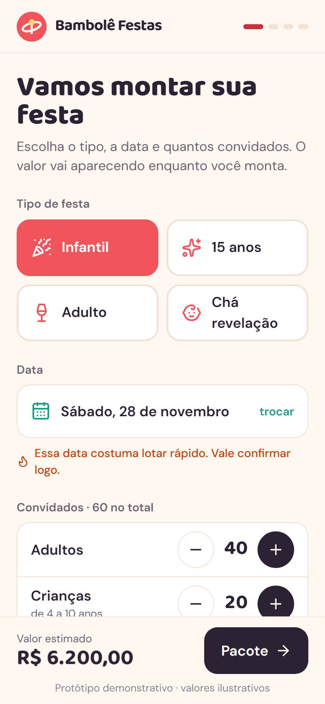
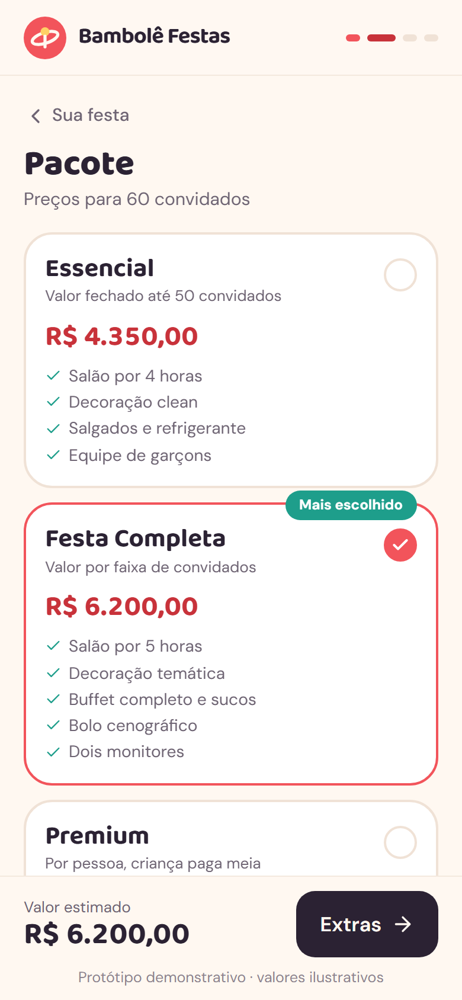
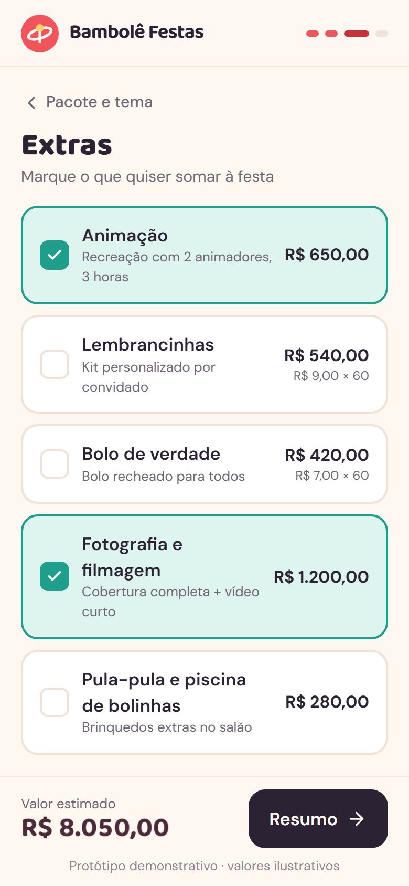
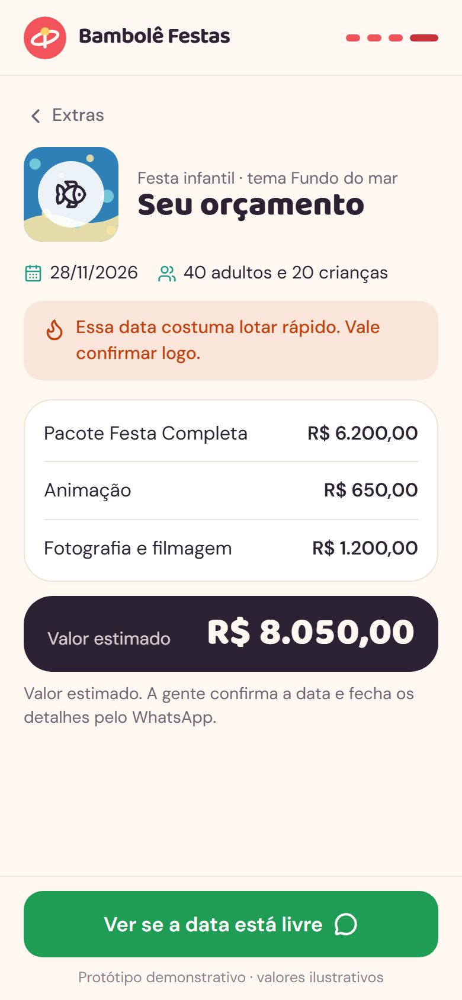

# 05 · Orçamento de Festa · palavra **FESTA**

Marca fictícia: **Bambolê Festas** (buffet e decoração inventado, salão no Cambeba).

A cliente escolhe o tipo de festa, a data e quantos convidados, compara três pacotes com o preço já calculado, escolhe um tema genérico (sem personagem licenciado), marca os extras e vê o valor estimado mudar na hora. No fim, "Ver se a data está livre" abre o WhatsApp do buffet com tudo preenchido. Datas concorridas aparecem com aviso.

| Sua festa | Pacote e tema | Extras | Resumo |
|---|---|---|---|
|  |  |  |  |

Mensagem gerada no fluxo do vídeo: [`docs/mensagem-whatsapp.txt`](docs/mensagem-whatsapp.txt).

## Como rodar

```bash
npm run dev -w apps/05-festa
npm run test -w apps/05-festa
npm run screens -- 05-festa
```

**Roteiro do vídeo:** adultos 30 → 40 e crianças 15 → 20 (60 convidados) → "Pacote" → Festa Completa (o do meio) → tema → "Extras" → animação e fotografia (o valor pisca e atualiza) → "Resumo" → "Ver se a data está livre".

A data já vem no primeiro sábado depois de 30 dias (sábado é "concorrido", então o aviso aparece no vídeo).

## Como adaptar para um cliente

**`marca.json`**: nome, logo, `whatsapp` do buffet, cores, fontes.

**`dados.json`**
- `local`: endereço/salão exibido.
- `tipos[]`: `{ id, rotulo, icone }` (ícones: `party`, `sparkles`, `wine`, `baby`; veja `src/components/Icone.tsx`).
- `convidados_padrao`: adultos e crianças iniciais.
- `pacotes[]`: três formatos, que cobrem praticamente todo buffet:
  - `"tipo": "fixo"`: `preco`, `max_convidados`, `excedente_por_pessoa`.
  - `"tipo": "faixa"`: `faixas[{ ate, preco }]` (até 50, 60, 70…), `excedente_por_pessoa` acima da última faixa.
  - `"tipo": "por_pessoa"`: `preco_adulto`, `fator_crianca` (0,5 = meia), `minimo_pessoas`.
  - Todos têm `id`, `nome`, `resumo`, `inclui[]` e `destaque` opcional ("Mais escolhido").
- `temas[]`: `{ id, nome, icone, cores[3], tipos[] }`. A capa é gerada com as 3 cores + ícone. `tipos` diz em quais festas o tema aparece.
- `extras[]`: `{ id, rotulo, descricao, preco, tipo }` com `tipo` = `fixo` ou `por_convidado`.
- `datas_concorridas`: `dias_semana` (6 = sábado) e `datas` específicas (AAAA-MM-DD).

**`mensagens.json`**: `orcamento` com `{tipo} {data} {adultos} {criancas} {pacote} {tema} {extras} {total}`; `textos` das telas.

## O que falta para virar produto

- Agenda real do salão (datas ocupadas de verdade) em `src/data/repository.ts`.
- Contrato, sinal por Pix e cronograma da festa.
- Fotos reais das decorações do buffet no lugar das capas geradas.
- Cardápio detalhado por pacote.

## Referências e créditos

- Software de gestão de buffet **Oni** (central de ajuda pública): três tipos de pacote (valor por pessoa com excedente e meia para crianças, valor fixo por faixa de convidados e valor fixo).
- Padrão de configurador com resumo de preço sempre visível.
- Capas de tema geradas em código. Ícones: [Lucide](https://lucide.dev) (ISC). Fontes: Baloo 2 e DM Sans (Google Fonts, OFL).
- Nenhum código de terceiros foi copiado.
