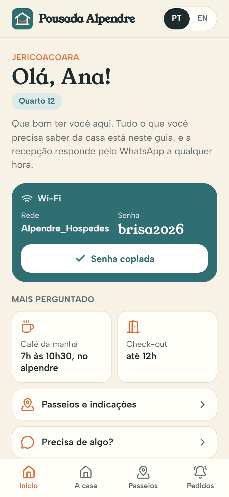
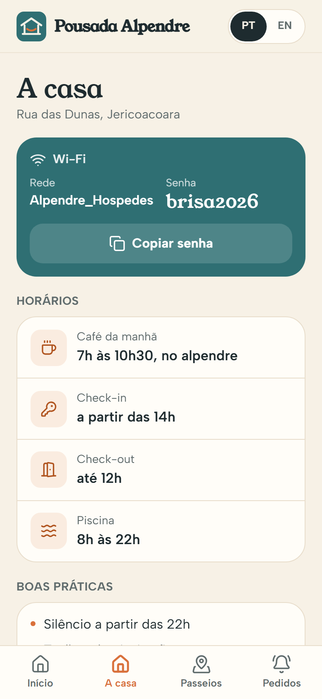
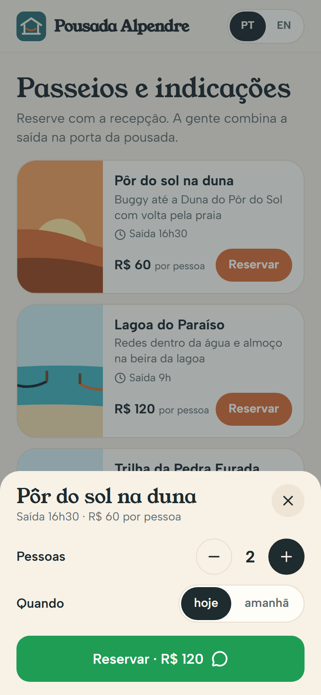
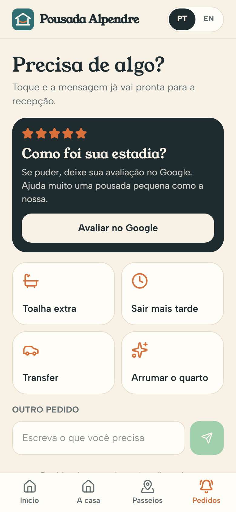

# 06 · Guia do Hóspede · palavra **GUIA**

Marca fictícia: **Pousada Alpendre** (pousada inventada em Jericoacoara).

A pousada manda um link no check-in com tudo o que o hóspede pergunta: senha do Wi-Fi com botão de copiar, horário do café, check-in e check-out, regras e contatos. Tem passeios para reservar pela recepção, lugares para comer com link do mapa, pedidos rápidos (toalha, sair mais tarde, transfer) e, no último dia, o convite para avaliar no Google. Tudo em português e inglês.

| Boas-vindas | A casa | Passeios | Pedidos |
|---|---|---|---|
|  |  |  |  |

Mensagem gerada no fluxo do vídeo: [`docs/mensagem-whatsapp.txt`](docs/mensagem-whatsapp.txt).

## Como rodar

```bash
npm run dev -w apps/06-guia
npm run test -w apps/06-guia
npm run screens -- 06-guia
```

## Link personalizado (sem banco de dados)

A recepção monta o link de cada hóspede com parâmetros na URL:

| Parâmetro | Exemplo | O que faz |
|---|---|---|
| `h` | `?h=Ana` | Nome na saudação e na mensagem |
| `q` | `&q=12` | Quarto |
| `saida` | `&saida=2026-11-02` | No dia da saída (ou depois) aparece o convite de avaliação |
| `ultimo` | `&ultimo=1` | Força o convite de avaliação (para a demo) |
| `lang` | `&lang=en` | Abre em inglês |

Exemplo: `.../guia/?h=Ana&q=12&saida=2026-11-02`. Sem `h` e `q`, o app pede nome e quarto antes de mandar mensagem.

**Roteiro do vídeo:** abre `?reset=1&h=Ana&q=12&ultimo=1` → "Copiar senha" → aba "A casa" (horário do café) → aba "Passeios" → "Reservar" no pôr do sol → "Reservar · R$ 120" → WhatsApp da recepção.

## Como adaptar para um cliente

**`marca.json`**: nome da pousada, logo, `whatsapp` da recepção, `cidade` (aparece na saudação), cores e fontes.

**`dados.json`** (todo texto que o hóspede lê tem versão `pt` e `en`)
- `local`, `avaliacao_google` (link de avaliação da ficha da pousada no Google).
- `wifi`: `rede` e `senha`.
- `horarios[]`: `{ id, icone, titulo, valor }`. `cafe` e `checkout` aparecem nos atalhos da tela inicial. Ícones: `coffee`, `key`, `door`, `waves`, `bath`, `clock`, `car`, `sparkles`.
- `regras`: listas `pt` e `en`.
- `contatos[]`: `{ titulo, valor }` (o valor vira link de telefone).
- `passeios[]`: `{ id, nome, descricao, horario, preco, cena }` (cenas: `por-do-sol`, `lagoa`, `pedra`, `kite`).
- `indicacoes[]`: `{ nome, tipo, dica, lat, lng }` (abre o Google Maps na coordenada).
- `pedidos[]`: `{ id, icone, titulo, texto }`. O `texto` completa a frase "Quero…".

**`mensagens.json`**: templates em `pt` e `en`. `pedido` usa `{nome} {quarto} {pedido} {detalhes}`; `detalhesPasseio` usa `{pessoas} {quando}`.

**`idiomas.json`**: todos os textos da interface (`pt` e `en` precisam ter as mesmas chaves; o teste confere).

## O que falta para virar produto

- Painel para a pousada editar o guia sozinha (o `repository.ts` já separa os dados).
- Integração com o sistema de reservas para gerar o link de cada hóspede automaticamente.
- PWA com cache offline (`vite-plugin-pwa`): ficou de fora para não arriscar compatibilidade com o Vite 8; o app já é leve e funciona com sinal fraco.
- Comissão de passeios e mais idiomas (espanhol é comum em Jeri).

## Referências e créditos

- **Touch Stay** e **Hostfully**: guia por link sem instalar app, marca própria, recomendações locais com mapa, venda de serviços extras dentro do guia, vários idiomas.
- Convite de avaliação igual para todos os hóspedes, sem filtrar quem avalia (regra do Google contra "review gating").
- Nomes de restaurantes são inventados; coordenadas aproximadas da vila.
- Ilustrações em SVG feitas para este projeto. Ícones: [Lucide](https://lucide.dev) (ISC). Fontes: Young Serif e Albert Sans (Google Fonts, OFL).
