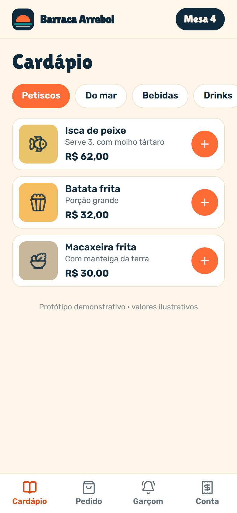
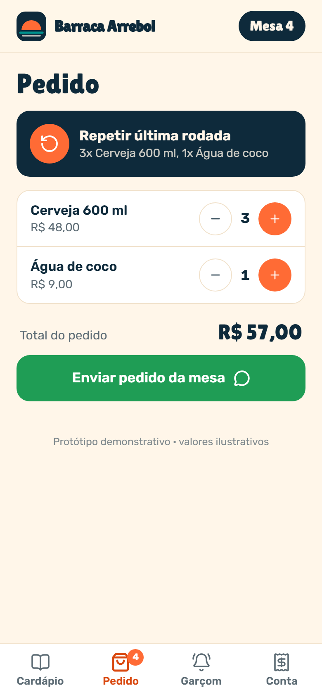
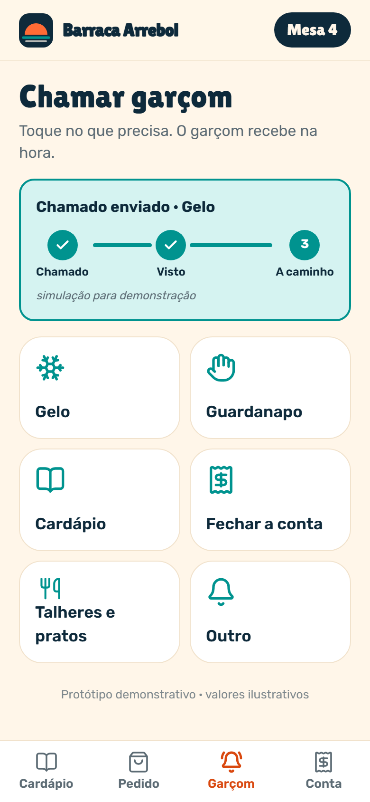
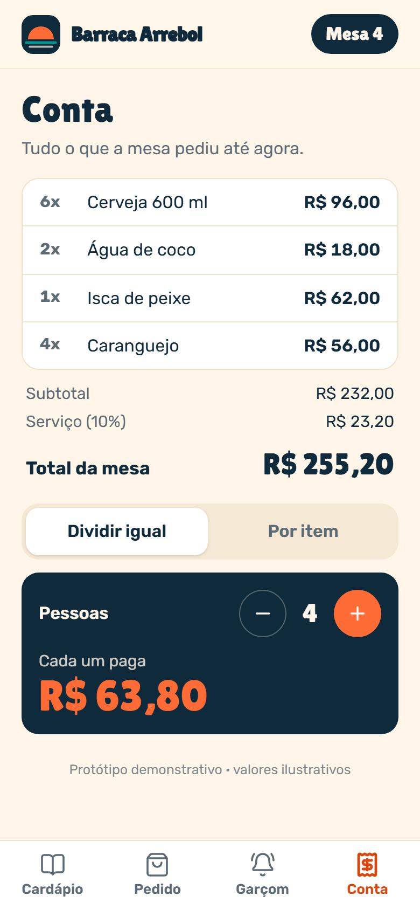
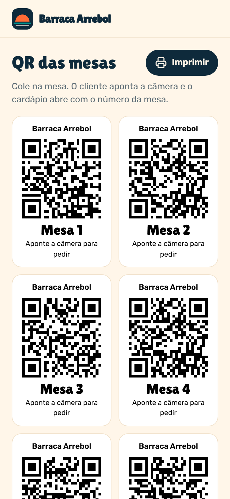

# 07 · Pedido na Mesa · palavra **MESA**

Marca fictícia: **Barraca Arrebol** (barraca de praia inventada na Praia do Futuro).

O cliente lê o QR da mesa e o cardápio já abre com o número dela. Pede, repete a última rodada de bebidas com um toque, chama o garçom (gelo, guardanapo, conta…) e vê a conta da mesa dividida igual por N pessoas ou por item. Pedidos e chamados chegam no WhatsApp da barraca com o número da mesa. Tem também a página `#/qr`, que gera e imprime os QR codes de todas as mesas.

| Cardápio | Pedido | Garçom | Conta | QR das mesas |
|---|---|---|---|---|
|  |  |  |  |  |

Mensagens geradas no fluxo do vídeo: [`docs/mensagem-whatsapp.txt`](docs/mensagem-whatsapp.txt).

## Como rodar

```bash
npm run dev -w apps/07-mesa
npm run test -w apps/07-mesa
npm run screens -- 07-mesa
```

**Roteiro do vídeo:** abre `?reset=1&mesa=4&demo=1` → aba "Pedido" → "Repetir última rodada" → "Enviar pedido da mesa" (status recebido → preparando → a caminho) → aba "Garçom" → "Gelo" → aba "Conta" → pessoas 2 → 4 → "Cada um paga R$ 63,80".

- `?mesa=N`: número da mesa (vem do QR).
- `?demo=1`: a mesa já começa com uma rodada pedida (`rodada_demo` no `dados.json`), para o "Repetir última rodada" aparecer no vídeo.
- `#/qr`: página para imprimir os QR codes (um por mesa, com `?mesa=N` no link).

Os status ("recebido → preparando → a caminho" e "chamado → visto → a caminho") são simulados e aparecem marcados como "simulação para demonstração".

## Como adaptar para um cliente

**`marca.json`**: nome da barraca, logo, `whatsapp` que recebe pedidos e chamados, cores, fontes.

**`dados.json`**
- `mesas`: quantos QR codes gerar em `#/qr`.
- `taxa_servico`: 0,1 = 10% na conta.
- `categorias[]`: `{ id, nome }` (abas do cardápio, na ordem).
- `cardapio[]`: `{ id, nome, descricao, preco, categoria, icone, cor, bebida }`. `bebida: true` entra no "Repetir última rodada". Ícones: `shrimp`, `fish`, `popcorn`, `salad`, `beer`, `citrus`, `cup`, `water`, `martini`, `glass`, `icecream`.
- `motivos_garcom[]`: `{ id, rotulo, icone }` (ícones: `snowflake`, `hand`, `book`, `receipt`, `utensils`, `bell`).
- `rodada_demo[]`: pedido inicial usado com `?demo=1`.

**`mensagens.json`**: `pedido` (`{mesa} {itens} {total}`), `item` (`{qtd} {nome} {valor}`), `garcom` (`{mesa} {motivo}`) e `textos` das telas. Use `*texto*` para negrito no WhatsApp.

## O que falta para virar produto

- Integração com caixa e cozinha (impressora/KDS) e status real do pedido (`salvarRodadas` em `src/data/repository.ts` é o ponto de troca).
- Conta compartilhada de verdade entre os celulares da mesa (hoje fica no celular de quem pediu).
- Pagamento na mesa (Pix) e fechamento de conta pelo garçom.
- Fotos reais dos pratos.

## Referências e créditos

- **QR Menu Card** (`CodecraftBySyed/QR-Menu-Card`): padrão de cardápio estático com mesa pela URL, carrinho em `localStorage`, checkout por `wa.me` e gerador de QR. Só o padrão de UX foi usado; nenhum código foi copiado.
- Plataformas de pedido na mesa (ex.: Fleksa): QR por mesa, chamar garçom com motivo, repetir rodada, dividir conta igual ou por item.
- QR codes gerados com [`qrcode`](https://github.com/soldair/node-qrcode) (MIT).
- Ícones: [Lucide](https://lucide.dev) (ISC). Fontes: Lilita One e Rubik (Google Fonts, OFL).
