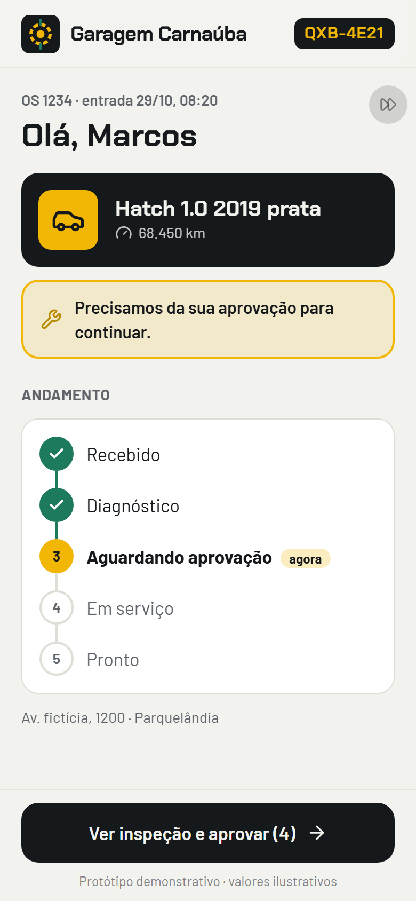
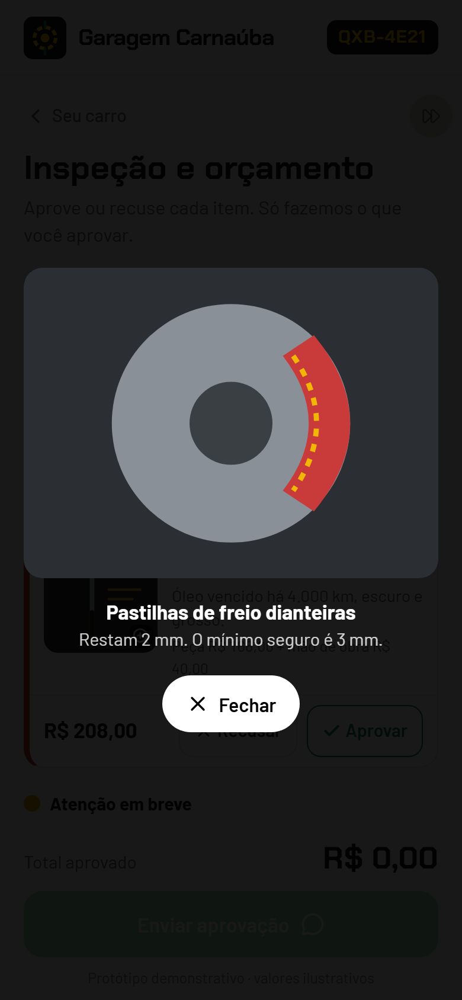
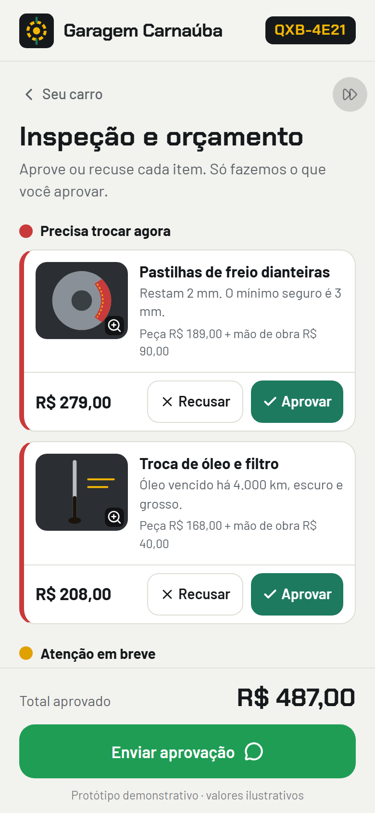
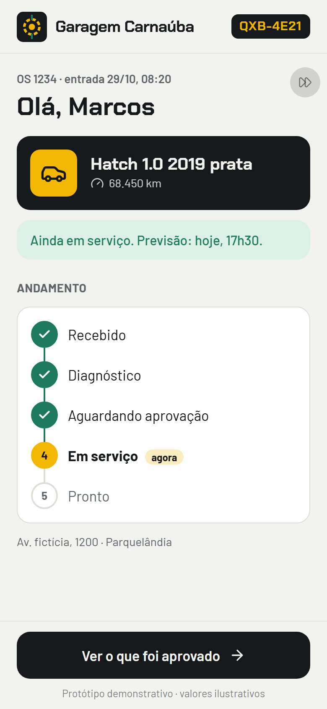
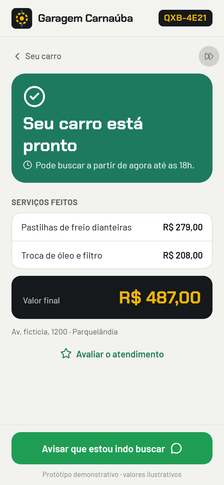

# 08 · Status do Carro · palavra **OFICINA**

Marca fictícia: **Garagem Carnaúba** (oficina inventada na Parquelândia).

O dono do carro recebe um link da OS e acompanha o serviço: linha do tempo (recebido → diagnóstico → aguardando aprovação → em serviço → pronto), achados da inspeção em vermelho, amarelo e verde com foto ampliável e nota do mecânico, valor de peça + mão de obra e aprovação ou recusa **item por item**. Ao enviar a aprovação pelo WhatsApp, a linha do tempo avança. Quando fica pronto, mostra horário de retirada e valor final, e convida todo cliente a avaliar no Google.

| Seu carro | Foto do achado | Inspeção | Andamento | Pronto |
|---|---|---|---|---|
|  |  |  |  |  |

Mensagem gerada no fluxo do vídeo: [`docs/mensagem-whatsapp.txt`](docs/mensagem-whatsapp.txt).

## Como rodar

```bash
npm run dev -w apps/08-oficina
npm run test -w apps/08-oficina
npm run screens -- 08-oficina
```

- `?os=1234`: escolhe a OS (se não existir, mostra a primeira).
- `?demo=1`: mostra um botão discreto (canto superior direito, ícone de avançar) que passa a OS para a próxima etapa. Use para gravar "em serviço → pronto".
- `?reset=1`: volta a OS para a etapa inicial e apaga as aprovações.

**Roteiro do vídeo:** abre `?reset=1&os=1234&demo=1` → "Ver inspeção e aprovar" → toca na foto da pastilha → fecha → "Aprovar" na pastilha e no óleo → "Enviar aprovação" → volta para a linha do tempo já em "Em serviço".

## Como adaptar para um cliente

**`marca.json`**: nome da oficina, logo, `whatsapp`, cores, fontes.

**`dados.json`**
- `endereco`, `avaliacao_google` (link de avaliação da ficha no Google).
- `etapas[]`: `{ id, rotulo }`. Os ids `aguardando`, `servico` e `pronto` são usados pelas telas; rótulos livres.
- `cores_achado`: rótulo e cor de `vermelho`, `amarelo`, `verde`.
- `ordens[]`: uma por OS: `os`, `cliente`, `carro`, `placa` (sem hífen), `km`, `entrada`, `etapa_inicial`, `previsao_pronto` e `achados[]`:
  - `{ id, titulo, cor, nota, foto, peca, mao_obra }`. `foto` escolhe o desenho (`pastilha`, `oleo`, `pneu`, `palheta`, `bateria`, `suspensao`). Itens verdes ou sem valor não pedem aprovação.

**`mensagens.json`**: `aprovacao` (`{os} {carro} {placa} {itens_aprovados} {itens_recusados} {total}`), `retirada` e `textos` das telas.

## O que falta para virar produto

- Painel da oficina para criar a OS, subir fotos do celular e mudar a etapa (o `repository.ts` é o ponto de troca).
- Envio automático do link por WhatsApp a cada mudança de etapa.
- Histórico do veículo (todas as OS da mesma placa) e lembrete de revisão.
- Assinatura/registro formal da aprovação.

## Referências e créditos

- **Inspeção Veicular Digital (DVI)**, padrão de Tekmetric, AutoLeap, Kimoby e da rede Christian Brothers: link por mensagem, linha do tempo de status, achados em verde/amarelo/vermelho com foto e nota, aprovação linha a linha pelo celular.
- Convite de avaliação igual para todos os clientes (regra do Google contra filtrar avaliações).
- "Fotos" dos achados são ilustrações SVG feitas para este projeto; placa e carro fictícios. Ícones: [Lucide](https://lucide.dev) (ISC). Fontes: Chakra Petch e Barlow (Google Fonts, OFL).
