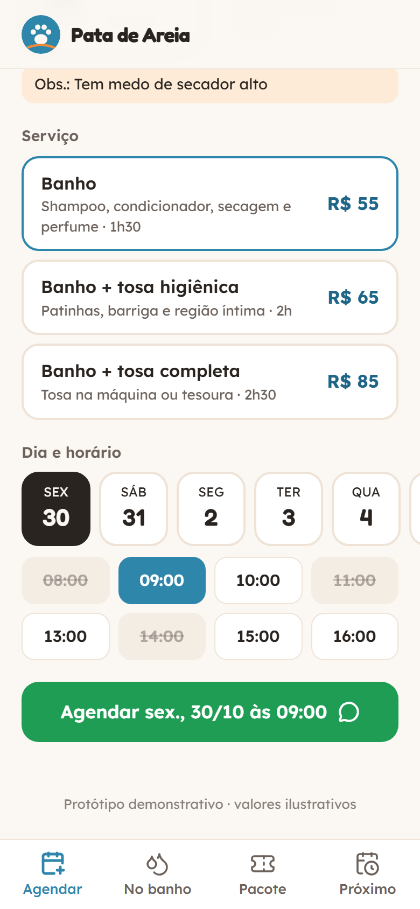
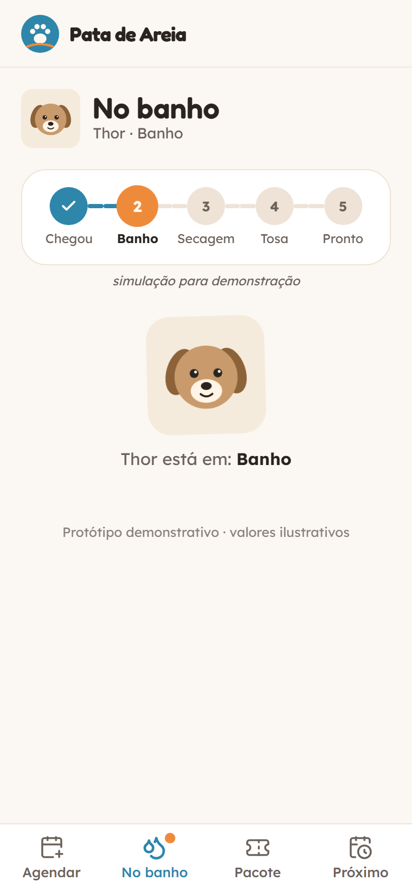
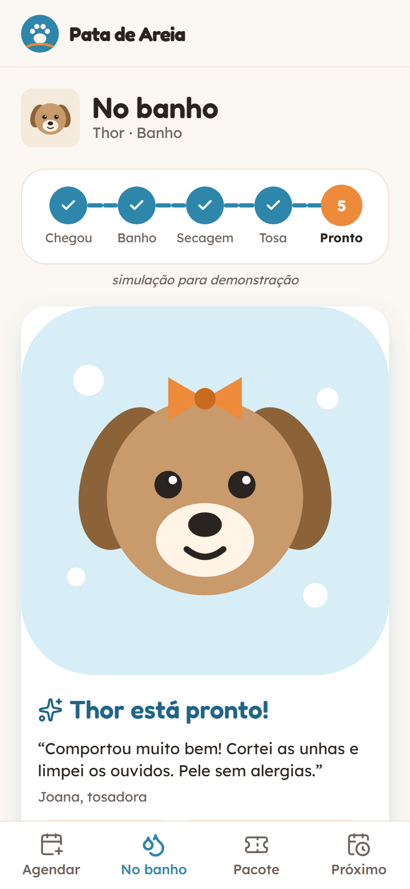
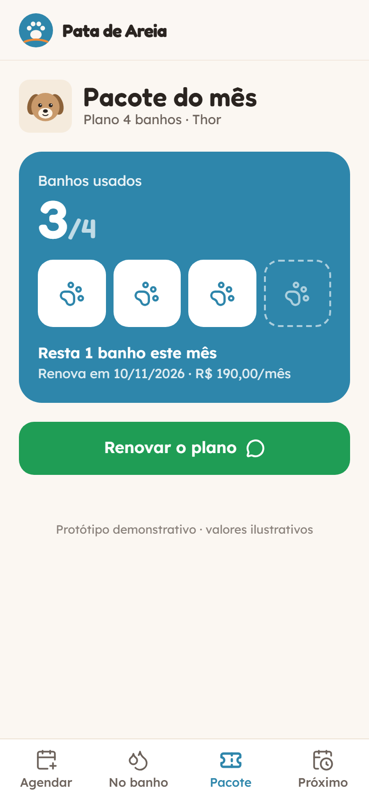
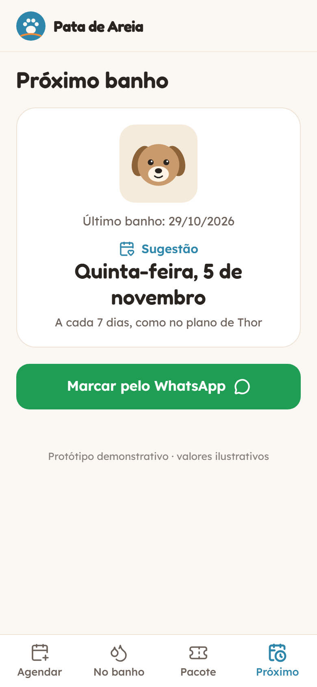

# 09 · Banho e Tosa · palavra **BANHO**

Marca fictícia: **Pata de Areia** (pet shop inventado no Meireles).

O tutor escolhe o pet (cadastro com foto, raça, porte e observações), o serviço com preço pelo porte e um horário livre, e agenda pelo WhatsApp. Na tela "No banho" acompanha a linha do tempo (chegou → banho → secagem → tosa → pronto); quando fica pronto chega o report card com a foto do pet arrumado, a nota da tosadora e os produtos usados, e o botão "Estou indo buscar". Tem ainda o pacote de 4 banhos por mês com contador e a sugestão do próximo banho.

| Agendar | No banho | Pronto | Pacote | Próximo |
|---|---|---|---|---|
|  |  |  |  |  |

Mensagens geradas no fluxo do vídeo: [`docs/mensagem-whatsapp.txt`](docs/mensagem-whatsapp.txt).

## Como rodar

```bash
npm run dev -w apps/09-pet
npm run test -w apps/09-pet
npm run screens -- 09-pet
```

**Roteiro do vídeo:** abre `?reset=1` → Thor, banho, primeiro horário livre → "Agendar" → a tela "No banho" avança sozinha (simulação, uma etapa a cada ~2 s) → aparece a foto do Thor pronto → "Estou indo buscar" → aba "Pacote" mostra 3/4.

A linha do tempo é simulada e aparece marcada como "simulação para demonstração". Horários ocupados também são simulados (sempre os mesmos para cada data).

## Como adaptar para um cliente

**`marca.json`**: nome do pet shop, logo, `whatsapp`, cores, fontes.

**`dados.json`**
- `endereco`, `portes` (rótulos de `pequeno`, `medio`, `grande`).
- `pets[]`: cadastro mock `{ id, nome, artigo ("o"/"a"), raca, porte, idade, obs, cor, orelha }`. `cor` e `orelha` pintam o retrato.
- `servicos[]`: `{ id, nome, descricao, duracao, precos: { pequeno, medio, grande } }`.
- `agenda`: `dias` mostrados, `fecha_domingo`, `horarios[]`.
- `etapas_banho[]`: nomes das etapas da linha do tempo (a última é "pronto").
- `report`: `tosadora`, `nota`, `produtos[]` do report card.
- `pacote`: `nome`, `banhos_mes`, `usados_inicio`, `preco`, `renova_em_dias`, `frequencia_dias` (usado no próximo banho).

**`mensagens.json`**: `agendamento` (`{pet} {porte} {servico} {data} {hora}`), `buscar` (`{artigo} {pet}`), `renovar`, `remarcar` e `textos` das telas.

## O que falta para virar produto

- Agenda real da equipe (horários livres de verdade) e cadastro do pet pelo tutor.
- O pet shop atualizar a etapa e mandar a foto real pelo celular (o `repository.ts` é o ponto de troca).
- Cobrança recorrente do plano e ficha de saúde/vacinas.

## Referências e créditos

- **MoeGo** (report card com foto por link), **Groomer.io** e **DaySmart Pet** (aviso de "pronto para buscar"), **Time To Pet** (report pós-visita) e pacotes recorrentes de banho.
- Retratos dos pets em SVG feitos para este projeto. Ícones: [Lucide](https://lucide.dev) (ISC). Fontes: Fredoka e Lexend (Google Fonts, OFL).
- Nenhum código de terceiros foi copiado.
