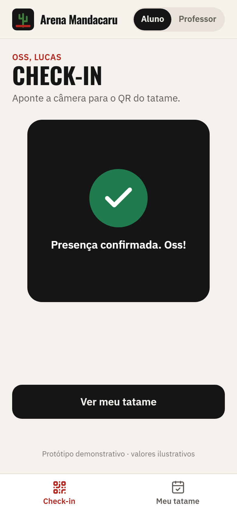
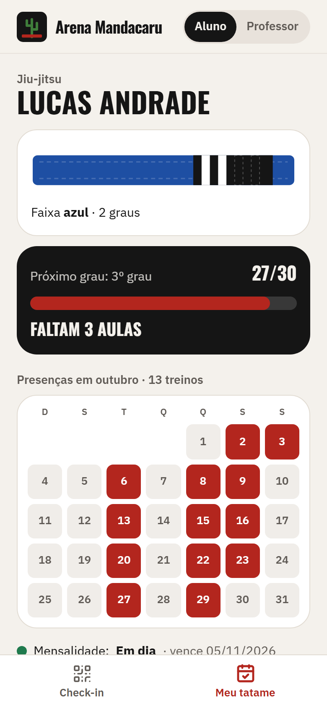
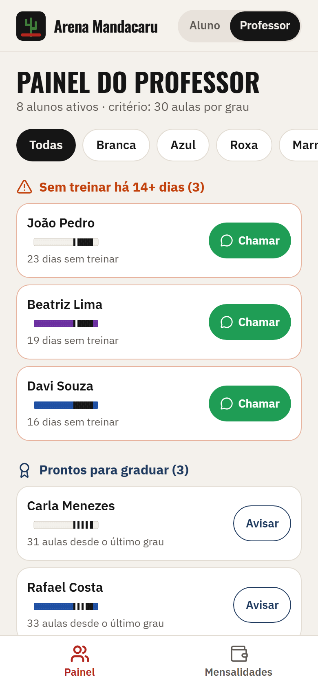
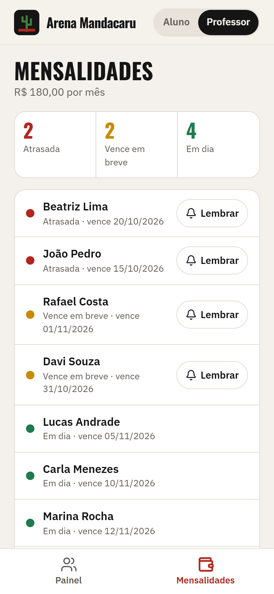

# 10 · Tatame · palavra **OSS**

Marca fictícia: **Arena Mandacaru** (academia de jiu-jitsu inventada).

Duas visões no mesmo link, alternadas no topo (sem login). **Aluno:** faz check-in lendo o QR do tatame (na demo, "Simular leitura"), vê a faixa desenhada com os graus, a barra até o próximo grau e o mapa de presenças do mês. **Professor:** vê quem está pronto para graduar, quem está sem treinar há 14 dias ou mais (com botão de mensagem), filtra por faixa e manda lembrete educado de mensalidade pelo WhatsApp.

| Check-in | Meu tatame | Painel do professor | Mensalidades |
|---|---|---|---|
|  |  |  |  |

Mensagem gerada no fluxo do vídeo: [`docs/mensagem-whatsapp.txt`](docs/mensagem-whatsapp.txt).

## Como rodar

```bash
npm run dev -w apps/10-tatame
npm run test -w apps/10-tatame
npm run screens -- 10-tatame
```

**Roteiro do vídeo:** abre `?reset=1` → "Simular leitura do QR" (linha de leitura + carimbo verde) → "Ver meu tatame" (27/30, faltam 3 aulas, hoje marcado no calendário) → toca em "Professor" → alerta "Sem treinar há 14+ dias" → "Chamar" no João.

## Como adaptar para um cliente

**`marca.json`**: nome da academia, logo, `whatsapp`, cores, fontes.

**`dados.json`**
- `modalidade`: aparece na tela do aluno (jiu-jitsu, judô, muay thai…).
- `aulas_por_grau`: critério de graduação (padrão 30; cada academia tem o seu).
- `graus_por_faixa`: quantos graus antes da próxima faixa.
- `dias_para_sumido`: a partir de quantos dias sem treinar o aluno entra no alerta.
- `aluno_logado`: id do aluno mostrado no modo aluno (na demo).
- `faixas[]`: `{ id, nome, cor, ponta }` na ordem de graduação. Para muay thai/judô, troque por prajieds/faixas da modalidade.
- `alunos[]`: `{ id, nome, faixa, graus, aulas_desde_grau, dias_sem_treinar, mensalidade{situacao, vence}, presencas_mes[], whatsapp }`.
- `situacoes`: rótulo e cor de `em_dia`, `vence_logo`, `atrasada`.
- `valor_mensalidade`.

**`mensagens.json`**: `sumido` (`{aluno}`), `lembrete` (`{aluno} {valor} {vence}`), `graduacao` (`{aluno}`) e `textos` das telas. O texto do aluno sumido é editável à vontade.

## O que falta para virar produto

- QR real (câmera) e registro de check-in no servidor (o `repository.ts` é o ponto de troca).
- Cadastro de alunos, várias turmas e horários, login do professor.
- Cobrança automática (Pix recorrente) e histórico de graduações.
- App instalável (PWA) para o aluno.

## Referências e créditos

- **House of Grapplers**, **Gymdesk**, **MyStudio** e **Clubworx**: check-in por QR ou quiosque, faixa e graus com critério de presenças desde o último grau, prontidão para graduar, alerta de aluno em risco, aluno vendo a própria evolução.
- Faixa e ilustrações em SVG feitas para este projeto. Ícones: [Lucide](https://lucide.dev) (ISC). Fontes: Oswald e IBM Plex Sans (Google Fonts, OFL).
- Nenhum código de terceiros foi copiado.
